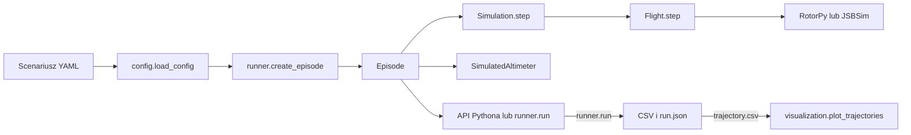

# Jak działa moduł symulacji

W symulacji **scenariusz** to opis wejściowy w YAML, **epizod** to jedno
uruchomienie tego scenariusza, a **misja** to trasa jednego pojazdu.
Jeden epizod może zawierać wiele pojazdów. Każdy ma własną misję i adapter
dynamiki, a wszystkie poruszają się według wspólnego zegara symulacji.

## Uruchamianie

Z katalogu głównego repozytorium uruchom `uv sync`, a następnie wybierz
scenariusz i nowy katalog wyników.

```sh
uv run python -m uav_onboard_planner.simulation \
  --config configs/simulation/scenarios/route_change.yaml \
  --output /tmp/uav-route-change-demo
```

W [katalogu scenariuszy](../../../configs/simulation/scenarios/) są przykłady
lotu dwóch pojazdów (`default.yaml`), zmiany trasy (`route_change.yaml`) oraz
anulowania misji z przerwą w pomiarach (`mission_cancellation.yaml`).
Scenariusz określa pojazdy, trasy, zegar i zdarzenia. Pole `altimeter` może
wskazywać [osobny profil czujnika](../../../configs/simulation/sensors/)
ścieżką względną od pliku scenariusza, np. `../sensors/altimeter.yaml`.
Pełny schemat YAML i opis wyników są w [dokumentacji użytkowej](../../../docs/simulation.md).

### Python

Importuj z konkretnych modułów. `simulation/__init__.py` zawiera opis pakietu.

| Potrzeba | Skąd importować |
| --- | --- |
| Wczytać scenariusz | `uav_onboard_planner.simulation.config.load_config` |
| Prowadzić epizod krok po kroku | `uav_onboard_planner.simulation.runner.create_episode` |
| Wykonać cały epizod i zapisać CSV oraz JSON | `uav_onboard_planner.simulation.runner.run` |
| Narysować trajektorie z zapisanego CSV | `uav_onboard_planner.simulation.visualization.plot_trajectories` |
| Zbudować trasę do przekazania w trakcie epizodu | `uav_onboard_planner.simulation.contracts.Mission` |
| Wstrzyknąć własną fabrykę symulacji, np. w teście | `uav_onboard_planner.simulation.episode.Episode` |

Poniższy kod uruchamia jeden krok w pamięci, podmienia trasę i czyta aktualny
stan czujnika. Można go wykonać z katalogu głównego przez `uv run python`.

```python
from pathlib import Path

from uav_onboard_planner.simulation.config import load_config
from uav_onboard_planner.simulation.contracts import Mission
from uav_onboard_planner.simulation.runner import create_episode

path = Path("configs/simulation/scenarios/route_change.yaml")
episode = create_episode(load_config(path))

samples = episode.step()
print(samples["survey"].state.position)
episode.replace_mission("survey", Mission(((4.0, 2.0, 10.0),), 0.5))
print(episode.altimeter_statuses()["survey"])
print(episode.altitude_observations().get("survey"))

episode.stop()
print(episode.outcome)
```

`snapshot()` odczytuje stan bez przesuwania zegara. `cancel_mission(name)`
kończy aktywną misję jednego pojazdu. `stop()` zatrzymuje cały epizod. Żeby
wykonać scenariusz do końca bez zapisu, wywołuj `step()` dopóki
`episode.finished` jest fałszywe. `reset()` odtwarza scenariusz i ziarna
losowe. Ręczne zmiany trzeba podać ponownie, jeśli mają wejść do odtwarzanego
przebiegu. Późniejsze zdarzenia z YAML nadal wykonują się po ręcznej zmianie.

## Kolejność czytania kodu

Śledź początkowo jeden pojazd i jeden krok. Szczegóły fizyki i zapisu można
zostawić do chwili, w której interesuje Cię ich konkretny wynik.

| Kolejność | Plik | Od czego zacząć |
| --- | --- | --- |
| 1 | [`__main__.py`](__main__.py) | `main()` pokazuje całą ścieżkę CLI od argumentów do zapisania wykresu. |
| 2 | [`runner.py`](runner.py) | `create_episode()` przekazuje ustawienia, a `create_simulation()` dobiera adapter dynamiki i tworzy `Flight` dla każdego pojazdu. `run()` prowadzi pętlę i zapisuje pliki. |
| 3 | [`episode.py`](episode.py) | `Episode.step()` określa kolejność fizyki, zdarzeń i pomiarów. `reset()` tworzy nową dynamikę, kolejkę zdarzeń i czujniki. |
| 4 | [`mission.py`](mission.py) i [`contracts.py`](contracts.py) | `Simulation.step()` przesuwa wszystkie loty o to samo `dt`. `Flight.step()` zalicza punkty i ustawia kolejny cel przez port `Autopilot`. Kontrakty definiują trasę, stan i jednostki. |
| 5 | [`config.py`](config.py) i [`scenario.py`](scenario.py) | `load_config()` ładuje i waliduje YAML oraz profile. `schedule()` sprawdza czasy, nazwy i konflikty zdarzeń oraz ustala ich kolejność. |
| 6 | [`adapters/rotorpy.py`](adapters/rotorpy.py) i [`adapters/jsbsim.py`](adapters/jsbsim.py) | `set_target()` i `step()` łączą symulację odpowiednio z dynamiką quadkoptera i stałopłata. Oba adaptery zwracają wspólny `FlightState`. |
| 7 | [`sensors/altimeter.py`](sensors/altimeter.py) i [`visualization.py`](visualization.py) | `SimulatedAltimeter.sample()` liczy szum i obsługuje kolejkę opóźnionych odczytów. Wykres powstaje z `trajectory.csv` po wykonaniu przebiegu. |

## Współpraca modułów



### Co dzieje się podczas kroku

1. `Episode` wybiera krok do następnego zdarzenia lub końca epizodu, nie
   dłuższy niż `time_step`.
2. `Simulation` wywołuje `Flight.step(dt)` dla każdego pojazdu. Adapter
   przesuwa dynamikę i zwraca stan. `Flight` zalicza osiągnięte punkty i
   zleca kolejny cel. Po ukończeniu albo anulowaniu misji przekazuje
   `set_target(None)`, co oznacza zawis quadkoptera lub podtrzymanie kursu
   i wysokości stałopłata.
3. Epizod stosuje zdarzenia zaplanowane na osiągniętą chwilę. Zmianę trasy
   widać od razu w statusie i indeksie punktu. Dynamika reaguje na nowy cel
   przy następnym kroku.
4. Wysokościomierz pobiera wysokość ze stanu po kroku. Epizod zwraca
   `FlightSample` dla każdego pojazdu i udostępnia pomiary gotowe w tej chwili.
   Runner zapisuje trajektorię zgodnie z `sample_interval`, a dostarczone
   odczyty wysokości zapisuje przy każdym kroku.

`FlightSample.state` to stan dynamiki w lokalnym układzie ENU (wschód,
północ, góra), w metrach i metrach na sekundę. `status` dotyczy misji
(`active`, `completed`, `cancelled`), a `waypoint` to indeks kolejnego
punktu liczony od zera. Po ukończeniu indeks jest równy liczbie punktów.
`episode.outcome` dotyczy całego epizodu i podaje przyczynę zakończenia
oraz czas ostatniego pełnego kroku. Błąd adaptera jest zgłaszany wywołującemu
i wymaga resetu przed dalszym odczytem lub symulacją.

Do odczytu wysokości użyj `altimeter_statuses()`, żeby rozróżnić brak
wyposażenia, oczekiwanie, przerwę i dostępny odczyt.
`altitude_observations()` zwraca ostatni dostępny pomiar dla wyposażonych
pojazdów lub `None`, gdy pomiaru brak. `altitude_updates()` zwraca tylko
pomiary dostarczone na bieżącym kroku. Pomiar zawiera czas jego wykonania
i najwcześniejszy czas dostępności. Faktyczny odbiór następuje na kroku
symulacji, którego czas zapisuje `altitude.csv`. Autopilot używa stanu
własnej dynamiki.

## Gdzie szukać przy zmianach

- **Format lub walidacja YAML.** Zacznij od `config.py` i
  [testów konfiguracji](../../../tests/simulation/test_config.py).
- **Zdarzenie, reset lub odczyt w konkretnym czasie.** Zacznij od `episode.py`,
  `scenario.py` i [testów epizodu](../../../tests/simulation/test_episode.py).
- **Zaliczanie punktów i statusy misji.** Zacznij od `mission.py` i
  [testów misji](../../../tests/simulation/test_mission.py).
- **Dynamika konkretnego pojazdu.** Zacznij od właściwego adaptera pod
  `adapters/` i [testów adapterów](../../../tests/simulation/test_adapters.py).
- **Pomiary lub pliki wynikowe.** Odczyty powstają w `sensors/`, a zapis
  plików jest w `runner.py`. Zobacz [testy wysokościomierza](../../../tests/simulation/test_altimeter.py)
  i [testy zapisu](../../../tests/simulation/test_runner.py).
